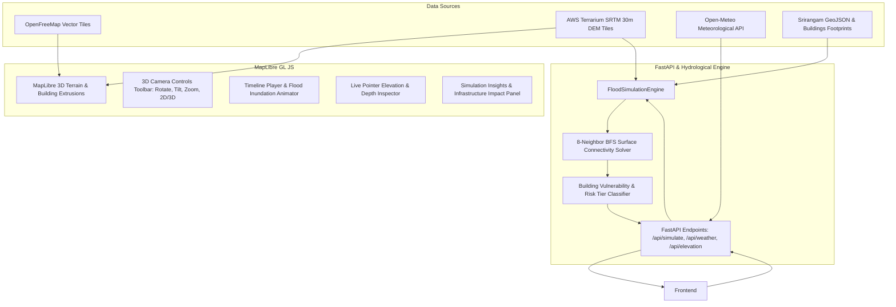

# Architecture — FloodSense DT

### Component Details
1. **Frontend:** Single-page application built with vanilla HTML5, CSS3, and modern JavaScript, powered by MapLibre GL JS v5.6.1. Supports full camera degree-of-freedom rotations, vertical pitch up to 75°, live elevation sampling, and multi-timestep animated inundation playback.
2. **Hydrological Simulation Engine:** Implemented in `backend/flood_simulation.py`. Samples the real SRTM 30m DEM grid (512x512 matrix), detects river channel seed coordinates along the Kaveri and Kollidam rivers, computes Water Surface Elevation (WSE) from scenario rainfall and surge parameters, and traverses surface elevation via 8-connected BFS.
3. **API Layer:** FastAPI with Pydantic validation, CORS middleware, in-memory caching for meteorological conditions, and full static file hosting.
